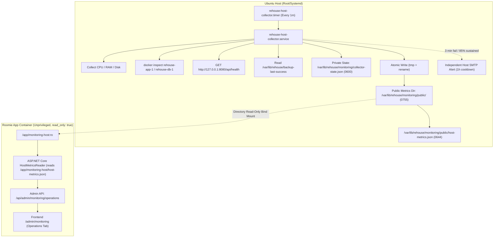

# Host Monitoring Contract & Ingestion Specification

> **T3a Preparation Contract**: This document defines the contract between the Ubuntu host systemd collector and the ASP.NET Core application runtime (`/admin/monitoring` Operations tab).

---

## 1. Architectural Model & Security Boundaries



### Security Invariants & Docker Mount Architecture
1. **No Docker Socket in App Container**: The ASP.NET Core container does NOT mount `/var/run/docker.sock`. Docker inspection is performed strictly by the host-level collector.
2. **Directory Bind Mount (No Inode Pinning)**: The host writes metrics into a dedicated public directory (`/var/lib/rehouse/monitoring/public/host-metrics.json`) atomically via temporary file replacement (`os.replace`, mode `0644`). The container mounts the *containing directory* read-only (`/var/lib/rehouse/monitoring/public:/app/monitoring-host:ro`).
   > [!IMPORTANT]
   > **Docker Inode Pinning Regression**: A single-file Docker bind mount (`/path/file.json:/path/file.json`) pins the initial file inode at container start. When the collector writes atomically via temporary file rename (`os.replace`), a new inode is allocated; a single-file mount continues pointing to the old unlinked inode and the container never sees updates. Mounting the containing dedicated directory `/var/lib/rehouse/monitoring/public` to `/app/monitoring-host:ro` allows the container to resolve filenames dynamically, ensuring every atomic replacement is instantly visible inside the container.
3. **Private Collector State Isolation**: `collector-state.json` (0600) is stored in the parent directory (`/var/lib/rehouse/monitoring/`), strictly outside the public mounted directory. The app container has no visibility into private alert tracking, failure counters, or notification queues.
4. **Independent Host Alerting & Failure Resilience**: When the application container or database is down, the app cannot execute code or send alerts. The host collector operates independently via host-level SMTP credentials in `/etc/rehouse/monitoring.env` or `/etc/rehouse/runtime.env`.
5. **No Secret or PII Leakage**: Container command strings, environment variables, connection strings, SMTP passwords, and user credentials are scrubbed and never serialized to the metrics JSON or alert emails.
6. **Backup Alert Authority**: The existing 27-hour watchdog (`rehouse-backup-watchdog.service` / `rehouse-backup-alert.py`) remains the sole authority for backup alerts. The host collector only surfaces backup timestamp and freshness status; it never sends duplicate backup emails.

---

## 2. File Paths and Mount Configuration

### Host Paths
| Path | Ownership | Permissions | Purpose |
|------|-----------|-------------|---------|
| `/var/lib/rehouse/monitoring/public/` | `root:root` | `0755` | Dedicated public directory for container read-only bind mount |
| `/var/lib/rehouse/monitoring/public/host-metrics.json` | `root:root` | `0644` | Atomic bounded metrics JSON for container consumption |
| `/var/lib/rehouse/monitoring/collector-state.json` | `root:root` | `0600` | Collector state (failure counters, active incidents, notification retry queue) - OUTSIDE public dir |
| `/var/lib/rehouse/backup-last-success` | `root:root` | `0600` | Existing backup watchdog timestamp marker |
| `/etc/rehouse/monitoring.env` | `root:root` | `0600` | Optional monitoring-specific SMTP overrides (`MONITORING_ALERT_TO`) |
| `/etc/rehouse/runtime.env` | `root:root` | `0600` | Standard production runtime environment (fallback SMTP config) |

### Docker Compose Mount Contract
In `deploy/compose.yaml` (under the `app` service):
```yaml
services:
  app:
    volumes:
      - app_keys:/app/data
      - /var/lib/rehouse/monitoring/public:/app/monitoring-host:ro
```

---

## 3. Data Schema: `host-metrics.json`

The file adheres to the following explicit JSON schema (Schema Version: `1.0`).

### Root Object

| Property | Type | Nullable | Description |
|----------|------|----------|-------------|
| `version` | `string` | No | Schema version, e.g. `"1.0"` |
| `generated_at` | `string` | No | ISO 8601 UTC timestamp of sample collection, e.g. `"2026-10-20T15:45:00Z"` |
| `collector` | `object` | No | Collector agent metadata (`version`, `status`, `duration_ms`) |
| `host` | `object` | No | Host-level resource metrics (CPU, RAM, Disk, Uptime) |
| `containers` | `object` | No | Map of monitored containers (`app`, `db`) |
| `services` | `object` | No | Monitored endpoint status (`api_health`, `backup_watchdog`) |
| `incidents` | `object` | No | Current active incidents and bounded history |
| `samples_history` | `object` | No | Bounded sliding window of recent minute-level metrics |

---

### Detailed Property Definitions

#### 1. `collector`
```json
{
  "version": "1.0.0",
  "status": "healthy",
  "duration_ms": 142
}
```

#### 2. `host`
```json
{
  "hostname": "ubuntu-vps",
  "os": "Ubuntu 24.04 LTS (Linux 6.8.0)",
  "uptime_seconds": 1284560,
  "cpu": {
    "percent": 18.5,
    "cores": 2,
    "load_1m": 0.42,
    "load_5m": 0.35,
    "load_15m": 0.28,
    "status": "healthy"
  },
  "memory": {
    "total_bytes": 2097152000,
    "used_bytes": 1048576000,
    "available_bytes": 1048576000,
    "percent": 50.0,
    "status": "healthy"
  },
  "disk": {
    "path": "/",
    "total_bytes": 53687091200,
    "used_bytes": 16106127360,
    "free_bytes": 37580963840,
    "percent": 30.0,
    "status": "healthy"
  }
}
```

- `percent`: Float rounded to 1 decimal place. When metric cannot be determined, `null` (never healthy `0`).
- `status`: Enum string: `"healthy"`, `"warning"`, `"critical"`, `"unknown"`.

#### 3. `containers`
```json
{
  "app": {
    "name": "rehouse-app-1",
    "service": "app",
    "status": "running",
    "health": "healthy",
    "running": true,
    "restart_count": 0,
    "started_at": "2026-10-20T10:00:00Z",
    "state_description": "healthy",
    "error": null
  },
  "db": {
    "name": "rehouse-db-1",
    "service": "db",
    "status": "running",
    "health": "healthy",
    "running": true,
    "restart_count": 0,
    "started_at": "2026-10-20T10:00:00Z",
    "state_description": "healthy",
    "error": null
  }
}
```

- `health`: `"healthy"`, `"unhealthy"`, `"starting"`, `"unknown"`.
- `status`: Docker container state string (`"running"`, `"exited"`, `"restarting"`, etc.).

#### 4. `services`
```json
{
  "api_health": {
    "url": "http://127.0.0.1:8080/api/health",
    "http_status": 200,
    "latency_ms": 12,
    "status": "healthy",
    "error": null
  },
  "backup_watchdog": {
    "last_success_path": "/var/lib/rehouse/backup-last-success",
    "last_success_at": "2026-10-20T03:15:00Z",
    "age_seconds": 45000,
    "threshold_seconds": 97200,
    "status": "healthy",
    "error": null
  }
}
```

- `backup_watchdog.status`: `"healthy"` (age <= 27h / 97200s), `"stale"` (age > 27h), `"unknown"` (marker missing).

#### 5. `incidents`
```json
{
  "active": [
    {
      "id": "inc_cpu_high_1729438800",
      "target": "cpu",
      "severity": "warning",
      "title": "Host CPU utilization >= 85% for 10 minutes",
      "opened_at": "2026-10-20T15:40:00Z",
      "last_notified_at": "2026-10-20T15:40:00Z",
      "consecutive_samples": 10,
      "current_value": "88.5%"
    }
  ],
  "recent_history": [
    {
      "id": "inc_app_unhealthy_1729430000",
      "target": "app",
      "severity": "critical",
      "title": "Application health check failed 3 consecutive times",
      "opened_at": "2026-10-20T13:00:00Z",
      "resolved_at": "2026-10-20T13:05:00Z",
      "duration_seconds": 300,
      "resolved_value": "Healthy (HTTP 200)"
    }
  ]
}
```

- Bounded size: `recent_history` is capped at 50 most recent resolved incidents.

#### 6. `samples_history`
Sliding window of up to 60 minute-level data points (1 hour) for immediate charting on the Operations tab:
```json
{
  "window_size": 60,
  "samples": [
    {
      "timestamp": "2026-10-20T15:44:00Z",
      "cpu_percent": 18.2,
      "ram_percent": 50.1,
      "disk_percent": 30.0,
      "app_healthy": true,
      "db_healthy": true
    },
    {
      "timestamp": "2026-10-20T15:45:00Z",
      "cpu_percent": 18.5,
      "ram_percent": 50.0,
      "disk_percent": 30.0,
      "app_healthy": true,
      "db_healthy": true
    }
  ]
}
```

---

## 4. Alerting Thresholds & Lifecycle Rules

| Monitored Target | Threshold Condition | Sustained Requirements | Notification Severity | Cooldown | Recovery Notice |
|---|---|---|---|---|---|
| `app` (Container + `/api/health`) | Container stopped/unhealthy OR loopback != 200 | 3 consecutive samples spaced >= 1 min (>= 2 min elapsed) | `critical` | 1 hour | Yes (Immediate) |
| `db` (`rehouse-db-1`) | Container stopped OR Docker health != healthy | 3 consecutive samples spaced >= 1 min (>= 2 min elapsed) | `critical` | 1 hour | Yes (Immediate) |
| `cpu` | Usage >= 85.0% | 10 samples spaced >= 1 min, >= 9 min elapsed | `warning` | 1 hour | Yes (Immediate) |
| `ram` | Usage >= 85.0% | 10 samples spaced >= 1 min, >= 9 min elapsed | `warning` | 1 hour | Yes (Immediate) |
| `disk` | Usage >= 85.0% | 5 samples spaced >= 1 min, >= 4 min elapsed | `warning` | 1 hour | Yes (Immediate) |
| `backup` | Age > 27 hours | N/A | Handled by existing watchdog | Handled by watchdog | Handled by watchdog |

### Container Health Evaluation Semantics
- **App Container (`rehouse-app-1`)**: The existing production `compose.yaml` does not declare a Docker `healthcheck` for `app`. When inspected, Docker returns no `Health` object. A running app container with absent Docker health (`health: "none"`) and a successful loopback probe (`GET http://127.0.0.1:8080/api/health` -> HTTP 200) is evaluated as **healthy**. Explicit alerts fire only when the container is stopped (`running: false`), explicit Docker health fails (`health: "unhealthy"`), or the loopback API fails.
- **Database Container (`rehouse-db-1`)**: Has a configured Docker healthcheck (`pg_isready`). Must report `health: "healthy"` and `running: true`.
- **Missing Docker Probe Data**: If `docker inspect` fails (e.g. daemon restart, timeout), container state is reported as `"unknown"` (`running: null`), **never fabricated as healthy nor assumed stopped**.

### Elapsed Timing, Spacing, and Gap Handling
- **Rapid Duplicate Rejection**: Samples with spacing < 55 seconds from the previous sample are rejected as duplicate/rapid runs and do not advance candidate streak counters or sustained durations.
- **Gap & Unknown Reset**: If a timer gap > 2 minutes (120 seconds) occurs, or if an intermediate sample evaluates to `"unknown"`, any candidate sustained streak is reset.
- **Open Incident Preservation**: An existing **OPEN** incident remains open during gaps or unknown states; it resolves **only upon proven healthy metrics**.
- **Bounded State Persistence**: Candidate streaks, start timestamps, active incidents, and notification queues are persisted to `/var/lib/rehouse/monitoring/collector-state.json` (0600) and survive collector process restarts.

### SMTP Delivery, Retry Queue, and Cooldown
- **Success-Gated Cooldown**: `last_notified_at` is updated **only after verified SMTP delivery**. Temporary SMTP delivery failure does NOT mark notification timestamps and never suppresses retries.
- **Persistent Pending Notification Queue**: Undelivered alerts and recovery notices are retained in `pending_notifications` with exponential backoff (up to 5 retries). Recovery notices are never dropped on transient email errors.
- **Systemd 45s Execution Bound**: Notification processing enforces a strict 20-second time budget per collector run, ensuring the overall oneshot execution cleanly completes well within systemd's `TimeoutStartSec=45s`.
- **Secret Isolation**: SMTP responses, passwords, and private pending notification items are kept strictly inside `collector-state.json` (0600) and are never exposed in the public `host-metrics.json`.
- **Delivery Disclaimer**: All alert emails append: `Note: SMTP acceptance by server does not guarantee final mailbox delivery (accepted != delivered).`

---

## 5. Backend Ingestion Recommendations (For Worker A / Task T3)

1. **File Reading**:
   - Backend reads `/app/monitoring-host/host-metrics.json` via the directory read-only bind mount `/var/lib/rehouse/monitoring/public:/app/monitoring-host:ro`.
   - If the file does not exist, backend returns `status: "unknown"` with descriptive message.
   - If `generated_at` is older than 3 minutes (180 seconds), backend marks host health as `"stale"`.
2. **DTO Mapping**:
   - Map `host-metrics.json` directly to C# record/class `HostMetricsDto` in `RoomRental.Api/Features/Admin/Monitoring/HostMetricsDto.cs`.
3. **Admin API Endpoint**:
   - `GET /api/admin/monitoring/operations`: Combines host metrics (`HostMetricsDto`) with in-memory / EF Core operational telemetry (route latency p95, 5xx rate, worker schedules).
