# Operations Monitoring, Telemetry, and Alerting Architecture (Task T3)

> **Specification & Operations Guide**: This document details the architectural design, ingestion contracts, worker instrumentation, incident lifecycle engine, and administrative endpoints for Roomie's operations monitoring system.

---

## 1. System Overview & Architecture

```mermaid
flowchart TD
    subgraph Host ["Ubuntu Host / Systemd"]
        Collector["rehouse-host-collector.service (1m timer)"] --> PublicDir["/var/lib/rehouse/monitoring/public/"]
        PublicDir --> HostMetricsFile["host-metrics.json (0644)"]
    end

    subgraph App ["ASP.NET Core Application Runtime"]
        subgraph Ingestion ["Host Ingestion"]
            HostMount["/app/monitoring-host:ro"] --> HostMetricsFile
            HostReader["LinuxHostCollectorMetricsReader"] -->|Reads & Parses| HostMount
        end

        subgraph Middleware ["HTTP Traffic Telemetry"]
            Traffic["HTTP Requests"] --> RouteMiddleware["RouteLatencyMiddleware"]
            RouteMiddleware --> RouteAggregator["RouteLatencyAggregator"]
            RouteAggregator --> RouteHistograms["Minute Buckets / P95 Histograms"]
        end

        subgraph Workers ["Worker Telemetry"]
            W1["InvoiceSweepService ('invoice-sweep')"] -->|Heartbeat| WorkerTracker["WorkerTelemetryTracker"]
            W2["PaymentReconciliationHostedService ('reconcile')"] -->|Heartbeat| WorkerTracker
            W3["PasswordRecoveryEmailWorker ('recovery-email')"] -->|Heartbeat| WorkerTracker
            W4["ZaloReminderWorker ('zalo')"] -->|Heartbeat| WorkerTracker
            W5["DataMaintenanceService ('cleanup')"] -->|Heartbeat| WorkerTracker
            W6["OpsMinuteFlushWorker ('ops-aggregation')"] -->|Heartbeat| WorkerTracker
            WorkerTracker --> WorkerDb["WorkerHeartbeats (EF Core)"]
        end

        subgraph OpsService ["Operations Service"]
            OpsMonitoring["OperationsMonitoringService"] --> RouteAggregator
            OpsMonitoring --> HostReader
            OpsMonitoring --> WorkerTracker
            OpsMonitoring --> QueueDb["AppDbContext (Queues)"]
        end

        subgraph Incidents ["Incident & Alerting Engine"]
            Engine["IncidentMonitoringService"] --> OpsMonitoring
            Engine --> IncidentDb["MonitoringIncidents (EF Core)"]
            Engine --> AlertNotifier["SmtpIncidentNotifier"]
            AlertNotifier --> Smtp["SMTP Email Alert (1h cooldown)"]
        end

        subgraph Endpoints ["Admin API Endpoints"]
            AdminOps["GET /api/admin/monitoring/operations"] --> OpsMonitoring
            AdminIncidents["GET /api/admin/monitoring/incidents"] --> Engine
            AdminAck["PATCH /api/admin/monitoring/incidents/{id}"] --> Engine
        end
    end
```



---

## 2. Route Latency Tracking & Aggregation

### Route Normalization & Cardinality Protection
Dynamic identifiers (GUIDs and numeric IDs) are normalized before aggregation to avoid high-cardinality memory leaks:
- Endpoint pattern fallback: `/api/invoices/{id}`
- Regex pattern matching:
  - GUIDs: `[0-9a-fA-F]{8}-[0-9a-fA-F]{4}-[0-9a-fA-F]{4}-[0-9a-fA-F]{4}-[0-9a-fA-F]{12}` -> `{id}`
  - Numeric IDs: `/(?:\d+)(?=/|$)` -> `/{id}`
- Strips query strings: `/api/invoices/123/items?page=1` -> `/api/invoices/{id}/items`

### Histogram Bucketing & P95 Computation
Each route minute bucket tracks request counts across latency thresholds:
- `<= 50ms`
- `50 - 100ms`
- `100 - 250ms`
- `250 - 500ms`
- `500 - 1000ms`
- `1000 - 2000ms`
- `> 2000ms`

P95 latency is interpolated within the target percentile bucket ($0.95 \times N$), providing microsecond accuracy without storing unbounded raw latency samples in memory.

### Sliding Time Windows
- Default window: `1h` (last 60 minute buckets).
- Custom window: `24h` (supported via `?window=24h`).
- Buckets older than 120 minutes are pruned continuously to guarantee constant $O(1)$ memory consumption.

---

## 3. Host Collector Ingestion (`LinuxHostCollectorMetricsReader`)

- **Path Resolution**: Ingests `/app/monitoring-host/host-metrics.json` via read-only bind mount `/var/lib/rehouse/monitoring/public:/app/monitoring-host:ro`. Supports configuration override (`Monitoring:HostMetricsPath`) and environment override (`MONITORING_HOST_METRICS_PATH`).
- **Real Collector JSON Schema**:
  - `incidents.active`: An array/list of active host incident objects, each with stable collector ID (`id`), `target`, `severity`, `title`, `current_value`, `consecutive_samples`, and `opened_at`.
  - `incidents.recent_history`: An array/list of historical resolved incident objects, each with stable collector ID, `resolved_at`, `duration_seconds`, and `resolved_value`.
  - `services.backup_watchdog`: Surfaces backup marker telemetry with default threshold of 27 hours (97200 seconds), `last_success_at`, `age_seconds`, and `status`.
- **Ingestion Guards & Bounded Resource Limits**:
  - **Bounded File Size**: Maximum file size limited to 2MB to guard against memory exhaustion.
  - **Max Parser Depth**: `JsonDocumentOptions` enforces `MaxDepth = 16`.
  - **Future Timestamp Protection**: If `generated_at` exceeds the system clock by > 2 minutes, it is rejected and marked stale/invalid (`RecordedAt = null`, `IsStale = true`).
  - **Out-of-Range & Non-Finite Filtering**: CPU%, RAM%, and Disk% metrics must be finite numbers in `[0.0, 100.0]`; out-of-range, NaN, or Infinity values are safely preserved as `null`.
  - **Absent Container Handling**: If the `containers` property is absent or empty, `containerCount` remains `null` rather than inventing `0` (which would wrongfully imply a catastrophic container outage).
- **Staleness Tracking**: Marked stale (`IsStale = true`) when `(now - recordedAt) > 180s` (3 collector cycles). Stale or missing data transitions dependent alerts to `Unknown`, keeping existing incidents active without wrongful auto-resolution.
- **Fault-Tolerant Parsing**: Malformed JSON or missing files return `null` and log debug/warning without throwing or crashing the API.

---

## 4. Worker Telemetry & Queue Instrumentation

### Tracked Background Workers
All 6 application background workers are instrumented to report lifecycle heartbeats:
1. `invoice-sweep`: Monthly invoice generation sweep (`InvoiceSweepService`).
2. `reconcile`: Scheduled payOS batch payment reconciliation (`PaymentReconciliationHostedService`).
3. `recovery-email`: Queued password reset and verification delivery (`PasswordRecoveryEmailWorker`).
4. `zalo`: Queued Zalo reminder notifications (`ZaloReminderWorker`).
5. `cleanup`: Ephemeral session and throttled token maintenance (`DataMaintenanceService`).
6. `ops-aggregation`: Route telemetry minute bucket EF Core flush and 30-day retention (`OpsMinuteFlushWorker`).

### Display-Only Mapping: `backup-watchdog`
To integrate with the frontend operations dashboard without requiring central DTO schema modifications, the host collector's authoritative `backup_watchdog` service is mapped into the `workers` array of `AdminMonitoringOperationsResponse`:
- **Worker Name**: `"backup-watchdog"`
- **Status & Staleness**: Reflects real status (`Healthy`, `Degraded`, or `Unknown`). If the host collector is stale (>180s), missing, or the backup marker age exceeds 27h (97200s), status is strictly `Unknown` and `IsStale = true`. Real stale or unknown states stay `Unknown` even if recent telemetry exists.
- **Timestamps**: Uses actual `last_success_at` derived from the filesystem marker mtime. No invented start or error timestamps (`LastStartedAt = null`, `LastErrorAt = null`).
- **Exclusion from App Alert Engine**: `backup-watchdog` is strictly **excluded** from the application's `IncidentMonitoringService` worker SLA/alert evaluation, because the autonomous Ubuntu host collector (`rehouse-host-collector.py`) is the sole 27-hour notification authority.

### Worker Status Semantics
- `Status`: `"Healthy"`, `"Degraded"`, `"Failed"`, `"Disabled"`, `"Unknown"`.
- `ConsecFailures`: Incremented on failure; reset to 0 upon healthy cycle completion.
- `IsStale`: Evaluated against per-worker SLAs:
  - `recovery-email`: 5 minutes (300s)
  - `zalo`: 5 minutes (300s)
  - `reconcile`: 10 minutes (600s)
  - `cleanup`: 20 minutes (1200s)
  - `ops-aggregation`: 2 hours (7200s)
  - `invoice-sweep`: 26 hours (93600s)
  - Default: 15 minutes
- Startup Grace Period: A 10-minute grace period from system startup prevents false stall alerts for newly started workers.
- Disabled Workers: Workers with `IsEnabled == false` are never marked stale or failed.

### Operational Queue Stats
- `ZaloPendingQueueCount`: Unsent reminders in `ZaloReminders` with `Status == 'Pending'`.
- `ZaloEligibleWindowCount`: Reminders where `QueuedAtMs <= nowMs`.
- `PayOsPendingReconcileCount`: Pending transactions in `PayOsAttempts` with `Status == PaymentAttemptStatus.Pending`.
- `SmtpAcceptedNotDeliveredCount`: Undelivered email attempts in `PasswordRecoveries` (`ProtectedCode != null` or `NotificationPending == true`).

---

## 5. Incident Engine & Alerting Rules

### Incident Lifecycle
- States: `Active` -> `Acknowledged` -> `Resolved`.
- Cooldown: 1 hour (3600 seconds) reminder cooldown. Initial alert fires immediately upon accepted delivery; subsequent reminder alerts fire once per hour.
- Notification Success Gating: `LastNotifiedAt` and `NotificationCount` are updated strictly **after** accepted SMTP delivery. If SMTP delivery fails (e.g. SMTP server unreachable), `LastNotifiedAt` remains null and notification remains pending for immediate retry next cycle without cooldown suppression.
- Recovery Notification Retries: When an incident resolves, a recovery notice is dispatched. If SMTP delivery fails, the incident is flagged for pending recovery retry in subsequent cycles until delivery succeeds.
- Explicit Auto-Recovery vs. Unknown State: An incident only auto-resolves when telemetry explicitly proves the condition is healthy. During periods of missing, stale, or insufficient telemetry (e.g. < 100 requests in 5-min/10-min window, or stale host metrics), active incidents remain open and are NEVER auto-resolved on silence or absent data.

### Evaluated Alert Rules
| Incident Key | Trigger Condition | Severity | Cooldown |
|---|---|---|---|
| `high_5xx_rate` | 5xx error rate > 5.0% sustained over 5 minutes (min 100 requests) | Critical (>= 10%) / Warning (>= 5%) | 1 hour |
| `high_p95_latency` | API P95 latency > 2000ms sustained over 10 minutes (min 100 requests) | Critical | 1 hour |
| `database_disconnected` | 3 consecutive probe failures at least 1 minute apart | Critical | 1 hour |
| `host_collector_stale` | Host collector metric age > 180 seconds | Warning | 1 hour |
| `host_cpu_high` | Host CPU utilization >= 85.0% sustained 10 minutes (consumed from collector) | Critical / Warning | 1 hour (collector managed) |
| `host_disk_high` | Host disk utilization >= 85.0% sustained 5 minutes (consumed from collector) | Critical / Warning | 1 hour (collector managed) |
| `worker_stalled_{name}` | Enabled background worker failed or exceeded per-worker SLA without heartbeat | Warning | 1 hour |

### Alert Email Delivery
Dispatched via `SmtpIncidentNotifier` to `MONITORING_ALERT_TO`.
All notification emails append the delivery disclaimer:
```
Note: SMTP acceptance by server does not guarantee final mailbox delivery (accepted != delivered).
```

---

## 6. Admin REST API Contracts

### 1. `GET /api/admin/monitoring/operations?window={1h|24h}`
Requires `Admin` role. Returns combined overview, route histogram latencies, host metrics, worker statuses, and queue depths:
```json
{
  "overview": {
    "overallStatus": "Healthy",
    "api5xxRatePercent": 0.0,
    "latencyP95Ms": 42.5,
    "totalRequestsLastHour": 1250,
    "databaseConnected": true,
    "databaseStatus": "Healthy",
    "window": "1h"
  },
  "routeMetrics": [
    {
      "routeTemplate": "/api/invoices/{id}",
      "httpMethod": "GET",
      "requestCount": 350,
      "status5xxCount": 0,
      "p95LatencyMs": 38.2,
      "avgLatencyMs": 14.1,
      "maxLatencyMs": 95.0
    }
  ],
  "hostMetrics": {
    "cpuPercent": 18.5,
    "memoryPercent": 50.0,
    "diskPercent": 30.0,
    "containerCount": 2,
    "healthEndpointStatus": "healthy",
    "hostStatus": "healthy",
    "recordedAt": "2026-10-20T16:00:00Z",
    "isStale": false
  },
  "workers": [
    {
      "workerName": "invoice-sweep",
      "isEnabled": true,
      "status": "Healthy",
      "lastStartedAt": "2026-10-20T15:00:00Z",
      "lastSuccessAt": "2026-10-20T15:00:05Z",
      "lastErrorAt": null,
      "lastErrorMessage": null,
      "isStale": false
    },
    {
      "workerName": "backup-watchdog",
      "isEnabled": true,
      "status": "Healthy",
      "lastStartedAt": null,
      "lastSuccessAt": "2026-10-20T15:00:00Z",
      "lastErrorAt": null,
      "lastErrorMessage": null,
      "isStale": false
    }
  ],
  "queues": {
    "zaloPendingQueueCount": 0,
    "zaloEligibleWindowCount": 0,
    "payOsPendingReconcileCount": 0,
    "smtpAcceptedNotDeliveredCount": 0
  }
}
```

> [!NOTE]
> **Histogram & UI Availability**: Root `histogramBuckets` is optional; when raw bucket distributions are not emitted by the backend, the frontend UI gracefully displays an "unavailable" state for the route histogram card without throwing errors.

### 2. `GET /api/admin/monitoring/incidents`
Returns active incident count and historical incident records:
```json
{
  "activeIncidentCount": 1,
  "incidents": [
    {
      "id": "3fa85f64-5717-4562-b3fc-2c963f66afa6",
      "incidentKey": "high_5xx_rate",
      "ruleName": "High API 5xx Error Rate",
      "severity": "Critical",
      "state": "Active",
      "summary": "API 5xx error rate is 12.5% over the last hour (>= 10% threshold)",
      "details": "Total requests: 200, 5xx rate: 12.5%",
      "startedAt": "2026-10-20T16:00:00Z",
      "lastNotifiedAt": "2026-10-20T16:00:00Z",
      "resolvedAt": null,
      "notificationCount": 1
    }
  ]
}
```

### 3. `PATCH /api/admin/monitoring/incidents/{id}`
Updates incident state (`Acknowledged` or `Resolved`) and appends operational notes:
```json
{
  "state": "Acknowledged",
  "note": "Investigating upstream gateway 502 responses."
}
```

---

## 7. Verification and Testing

Execute the test suites via:
```bash
# 1. C# Webhook & Operations Monitoring Test Suite (including HTTP endpoints, workers, incident engine)
dotnet run --project tests/RoomRental.WebhookTests/RoomRental.WebhookTests.csproj

# 2. Host Collector Python Test Suite (timing, streak counters, SMTP queue, Docker health)
python3 tests/test_host_collector.py
```
