# Operations Monitoring, Telemetry, and Alerting Architecture (Task T3)

> **Specification & Operations Guide**: This document details the architectural design, ingestion contracts, worker instrumentation, incident lifecycle engine, and administrative endpoints for Roomie's operations monitoring system.

---

## 1. System Overview & Architecture

```mermaid
flowchart TD
    subgraph Host ["Ubuntu Host / Systemd"]
        Collector["rehouse-host-collector.service (1m timer)"] --> PublicDir["/var/lib/rehouse/monitoring/public/"]
        PublicDir --> HostMetricsFile["host-metrics.json (0644)"]
    end

    subgraph App ["ASP.NET Core Application Runtime"]
        subgraph Ingestion ["Host Ingestion"]
            HostMount["/app/monitoring-host:ro"] --> HostMetricsFile
            HostReader["LinuxHostCollectorMetricsReader"] -->|Reads & Parses| HostMount
        end

        subgraph Middleware ["HTTP Traffic Telemetry"]
            Traffic["HTTP Requests"] --> RouteMiddleware["RouteLatencyMiddleware"]
            RouteMiddleware --> RouteAggregator["RouteLatencyAggregator"]
            RouteAggregator --> RouteHistograms["Minute Buckets / P95 Histograms"]
        end

        subgraph Workers ["Worker Telemetry"]
            W1["InvoiceSweepService ('invoice-sweep')"] -->|Heartbeat| WorkerTracker["DefaultWorkerStateTracker"]
            W2["PaymentReconciliationHostedService ('reconcile')"] -->|Heartbeat| WorkerTracker
            W3["PasswordRecoveryEmailWorker ('recovery-email')"] -->|Heartbeat| WorkerTracker
            W4["ZaloReminderWorker ('zalo')"] -->|Heartbeat| WorkerTracker
            W5["DataMaintenanceService ('cleanup')"] -->|Heartbeat| WorkerTracker
            W6["MonitoringAggregationWorker ('aggregation')"] -->|Heartbeat| WorkerTracker
            WorkerTracker --> WorkerDb["WorkerHeartbeats (EF Core)"]
        end

        subgraph OpsService ["Operations Service"]
            OpsMonitoring["OperationsMonitoringService"] --> RouteAggregator
            OpsMonitoring --> HostReader
            OpsMonitoring --> WorkerTracker
            OpsMonitoring --> QueueDb["AppDbContext (Queues)"]
        end

        subgraph Incidents ["Incident & Alerting Engine"]
            Engine["IncidentEngine / IncidentMonitoringService"] --> OpsMonitoring
            Engine --> IncidentDb["MonitoringIncidents (EF Core)"]
            Engine --> AlertNotifier["SmtpIncidentAlertNotifier"]
            AlertNotifier --> Smtp["SMTP Email Alert (1h cooldown)"]
        end

        subgraph Endpoints ["Admin API Endpoints"]
            AdminOps["GET /api/admin/monitoring/operations"] --> OpsMonitoring
            AdminIncidents["GET /api/admin/monitoring/incidents"] --> Engine
            AdminAck["PATCH /api/admin/monitoring/incidents/{id}"] --> Engine
        end
    end
```



---

## 2. Route Latency Tracking & Aggregation

### Route Normalization & Cardinality Protection
Dynamic identifiers (GUIDs and numeric IDs) are normalized before aggregation to avoid high-cardinality memory leaks:
- Endpoint pattern fallback: `/api/invoices/{id}`
- Regex pattern matching:
  - GUIDs: `[0-9a-fA-F]{8}-[0-9a-fA-F]{4}-[0-9a-fA-F]{4}-[0-9a-fA-F]{4}-[0-9a-fA-F]{12}` -> `{id}`
  - Numeric IDs: `/(?:\d+)(?=/|$)` -> `/{id}`
- Strips query strings: `/api/invoices/123/items?page=1` -> `/api/invoices/{id}/items`

### Histogram Bucketing & P95 Computation
Each route minute bucket tracks request counts across latency thresholds:
- `<= 50ms`
- `50 - 100ms`
- `100 - 250ms`
- `250 - 500ms`
- `500 - 1000ms`
- `1000 - 2000ms`
- `> 2000ms`

P95 latency is interpolated within the target percentile bucket ($0.95 \times N$), providing microsecond accuracy without storing unbounded raw latency samples in memory.

### Sliding Time Windows
- Default window: `1h` (last 60 minute buckets).
- Custom window: `24h` (supported via `?window=24h`).
- Buckets older than 120 minutes are pruned continuously to guarantee constant $O(1)$ memory consumption.

---

## 3. Host Collector Ingestion (`LinuxHostCollectorMetricsReader`)

- **Path Resolution**: Ingests `/app/monitoring-host/host-metrics.json` via read-only bind mount `/var/lib/rehouse/monitoring/public:/app/monitoring-host:ro`. Supports configuration override (`Monitoring:HostMetricsPath`) and environment override (`MONITORING_HOST_METRICS_PATH`).
- **Staleness Bound**: 180 seconds (3 minutes) from `generated_at`. If older, `IsStale = true`.
- **Nullable Value Preservation**: Unknown or uncollected CPU/RAM/Disk metrics remain `null`; never fabricated as healthy `0.0`.
- **Fault-Tolerant Parsing**: Malformed JSON or missing files return `null` and log debug/warning without throwing or crashing the API.

---

## 4. Worker Telemetry & Queue Instrumentation

### Tracked Background Workers
All 6 application background workers are instrumented to report lifecycle heartbeats:
1. `invoice-sweep`: Monthly invoice generation sweep (`InvoiceSweepService`).
2. `reconcile`: Scheduled payOS batch payment reconciliation (`PaymentReconciliationHostedService`).
3. `recovery-email`: Queued password reset and verification delivery (`PasswordRecoveryEmailWorker`).
4. `zalo`: Queued Zalo reminder notifications (`ZaloReminderWorker`).
5. `cleanup`: Ephemeral session and throttled token maintenance (`DataMaintenanceService`).
6. `aggregation`: Daily business analytics and traffic rollups (`MonitoringAggregationWorker`).

### Worker Status Semantics
- `Status`: `"Healthy"`, `"Degraded"`, `"Failed"`, `"Disabled"`.
- `ConsecFailures`: Incremented on failure; reset to 0 upon healthy cycle completion.
- `IsStale`: True if `now - UpdatedAt > 10 minutes`.

### Operational Queue Stats
- `ZaloPendingQueueCount`: Unsent reminders in `ZaloReminders` with `Status == 'Pending'`.
- `ZaloEligibleWindowCount`: Reminders where `QueuedAtMs <= nowMs`.
- `PayOsPendingReconcileCount`: Pending transactions in `PayOsAttempts` with `Status == PaymentAttemptStatus.Pending`.
- `SmtpAcceptedNotDeliveredCount`: Undelivered email attempts in `PasswordRecoveries` (`ProtectedCode != null` or `NotificationPending == true`).

---

## 5. Incident Engine & Alerting Rules

### Incident Lifecycle
- States: `Active` -> `Acknowledged` -> `Resolved`.
- Cooldown: 1 hour (3600 seconds) reminder cooldown. Initial alert fires immediately; subsequent alerts for the same active condition fire once per hour.
- Auto-Recovery: When operational conditions normalize, the active incident automatically transitions to `Resolved`, and an immediate recovery notice is dispatched.

### Evaluated Alert Rules
| Incident Key | Trigger Condition | Severity | Cooldown |
|---|---|---|---|
| `high_5xx_rate` | 5xx error rate >= 10.0% (Critical) / >= 5.0% (Warning) | Critical / Warning | 1 hour |
| `high_p95_latency` | API P95 latency >= 2000ms (Critical) / >= 1000ms (Warning) | Critical / Warning | 1 hour |
| `database_disconnected` | `CanConnectAsync() == false` | Critical | 1 hour |
| `host_collector_stale` | Host collector metric age > 180 seconds | Warning | 1 hour |
| `host_cpu_high` | Host CPU utilization >= 85.0% (Warning) / >= 95.0% (Critical) | Critical / Warning | 1 hour |
| `host_disk_high` | Host disk utilization >= 85.0% (Warning) / >= 95.0% (Critical) | Critical / Warning | 1 hour |
| `host_memory_high` | Host RAM utilization >= 85.0% (Warning) / >= 95.0% (Critical) | Critical / Warning | 1 hour |
| `worker_failure_{name}` | Background worker failed or consecutive failures >= 3 | Critical / Warning | 1 hour |

### Alert Email Delivery
Dispatched via `SmtpIncidentAlertNotifier` to `MONITORING_ALERT_TO`.
All notification emails append the delivery disclaimer:
```
Note: SMTP acceptance by server does not guarantee final mailbox delivery (accepted != delivered).
```

---

## 6. Admin REST API Contracts

### 1. `GET /api/admin/monitoring/operations?window={1h|24h}`
Requires `Admin` role. Returns combined overview, route histogram latencies, host metrics, worker statuses, and queue depths:
```json
{
  "overview": {
    "overallStatus": "Healthy",
    "api5xxRatePercent": 0.0,
    "latencyP95Ms": 42.5,
    "totalRequestsLastHour": 1250,
    "databaseConnected": true,
    "databaseStatus": "Healthy",
    "window": "1h"
  },
  "routeMetrics": [
    {
      "routeTemplate": "/api/invoices/{id}",
      "httpMethod": "GET",
      "requestCount": 350,
      "status5xxCount": 0,
      "p95LatencyMs": 38.2,
      "avgLatencyMs": 14.1,
      "maxLatencyMs": 95.0
    }
  ],
  "hostMetrics": {
    "cpuPercent": 18.5,
    "memoryPercent": 50.0,
    "diskPercent": 30.0,
    "containerCount": 2,
    "healthEndpointStatus": "healthy",
    "hostStatus": "healthy",
    "recordedAt": "2026-10-20T16:00:00Z",
    "isStale": false
  },
  "workers": [
    {
      "workerName": "invoice-sweep",
      "isEnabled": true,
      "status": "Healthy",
      "lastStartedAt": "2026-10-20T15:00:00Z",
      "lastSuccessAt": "2026-10-20T15:00:05Z",
      "lastErrorAt": null,
      "lastErrorMessage": null,
      "isStale": false
    }
  ],
  "queues": {
    "zaloPendingQueueCount": 0,
    "zaloEligibleWindowCount": 0,
    "payOsPendingReconcileCount": 0,
    "smtpAcceptedNotDeliveredCount": 0
  }
}
```

### 2. `GET /api/admin/monitoring/incidents`
Returns active incident count and historical incident records:
```json
{
  "activeIncidentCount": 1,
  "incidents": [
    {
      "id": "3fa85f64-5717-4562-b3fc-2c963f66afa6",
      "incidentKey": "high_5xx_rate",
      "ruleName": "High API 5xx Error Rate",
      "severity": "Critical",
      "state": "Active",
      "summary": "API 5xx error rate is 12.5% over the last hour (>= 10% threshold)",
      "details": "Total requests: 200, 5xx rate: 12.5%",
      "startedAt": "2026-10-20T16:00:00Z",
      "lastNotifiedAt": "2026-10-20T16:00:00Z",
      "resolvedAt": null,
      "notificationCount": 1
    }
  ]
}
```

### 3. `PATCH /api/admin/monitoring/incidents/{id}`
Updates incident state (`Acknowledged` or `Resolved`) and appends operational notes:
```json
{
  "state": "Acknowledged",
  "note": "Investigating upstream gateway 502 responses."
}
```

---

## 7. Verification and Testing

Execute the test suites via:
```bash
# 1. C# Webhook & Operations Monitoring Test Suite (including HTTP endpoints, workers, incident engine)
dotnet run --project tests/RoomRental.WebhookTests/RoomRental.WebhookTests.csproj

# 2. Host Collector Python Test Suite (timing, streak counters, SMTP queue, Docker health)
python3 tests/test_host_collector.py
```
